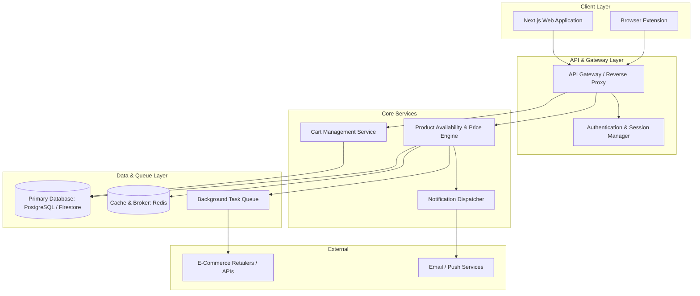

# Your_Cart

> **Universal Shopping Cart & Intelligent Product Availability and Price Tracking Platform**

---

## 📌 Overview

**Your_Cart** is an all-in-one shopping cart aggregator and intelligent tracking platform designed to eliminate e-commerce fragmentation. It enables shoppers to track products, monitor inventory availability across diverse retailers, and receive automated price-drop notifications from a unified dashboard.

---

## ⚠️ Development Status

> **Current Phase: Pre-Alpha / Repository Setup**  
> This repository is currently in its initial infrastructure and scaffolding stage. Application components and service modules described below are planned and under active architectural design. None of the tracking, scraping, or cart features are functional in this commit.

---

## 🎯 Problem Statement

Online shoppers frequently encounter several pain points:
- **Cart Fragmentation:** Saving items across dozens of separate retailer sites with disparate accounts and wishlists.
- **Volatile Pricing:** Frequent price fluctuations without a dependable way to know when an item hits a target price or historical low.
- **Unpredictable Stock:** Products quickly going out of stock across vendors without instant restock notifications.
- **Privacy & Noise:** Marketing spam instead of concise, actionable availability and price signals.

---

## 🚀 Main Objectives

1. **Unified Shopping Experience:** Enable users to curate a single master cart spanning multiple e-commerce vendors.
2. **Automated Price Monitoring:** Continuously evaluate product price histories and trigger real-time alerts upon reaching user-defined thresholds.
3. **Availability & Restock Tracking:** Detect stock status changes across supported stores to notify shoppers immediately.
4. **Cloud-Native & Modular Design:** Implement decoupled microservices prepared for elastic scaling, rate-limit resilience, and strict credential hygiene.

---

## 🛠️ Planned Features

- [ ] **Universal Cart Aggregator:** Single-pane interface to view, tag, and organize products saved from any supported retail website.
- [ ] **Intelligent Price Engine:** Scheduled background polling and parsing to record price movements and calculate percentage drops.
- [ ] **Restock & Inventory Alerts:** Real-time triggers for back-in-stock events and low-inventory warnings.
- [ ] **Multi-Channel Notifications:** Alerts delivered through Email, Web Push notifications, and Webhooks.
- [ ] **Browser Extension Companion:** One-click product capture directly from online merchant product pages.
- [ ] **Historical Price Analytics:** Interactive visual charts depicting price history, 30-day averages, and best purchase windows.

---

## 🏗️ Proposed Architecture

---

## 💻 Planned Technology Stack

| Domain | Technology / Tools |
| :--- | :--- |
| **Frontend** | [Next.js](https://nextjs.org/) (React), TypeScript, Tailwind CSS |
| **Backend Services** | [Python](https://www.python.org/) ([FastAPI](https://fastapi.tiangolo.com/)) / [Node.js](https://nodejs.org/) |
| **Database & Cache** | PostgreSQL / Firebase Firestore, Redis |
| **Task Queue & Polling** | Celery / Cloud Tasks / Pub/Sub |
| **DevOps & Infrastructure** | Docker, GitHub Actions, Google Cloud Platform (GCP) |

---

## 🗺️ Roadmap

- **Phase 1: Project Initialization & Git Infrastructure** *(Current)*
  - Establish repository structure, `.gitignore`, and Git/GitHub setup.
- **Phase 2: Architectural Specifications & Data Modeling**
  - Database schema definitions, API contracts, and vendor adapter abstractions.
- **Phase 3: Core Scraper & Tracker Engine**
  - Resilient product extraction pipeline and price history database integration.
- **Phase 4: Unified Cart Web Application**
  - User authentication, cart organization, and dashboard analytics.
- **Phase 5: Notification Service & Browser Extension**
  - Multi-platform alerts and companion browser plugin.
- **Phase 6: CI/CD Automation & Production Deployment**
  - Automated testing, containerization, and staging deployments.

---

## 📄 License

This repository is proprietary and private. All rights reserved.

